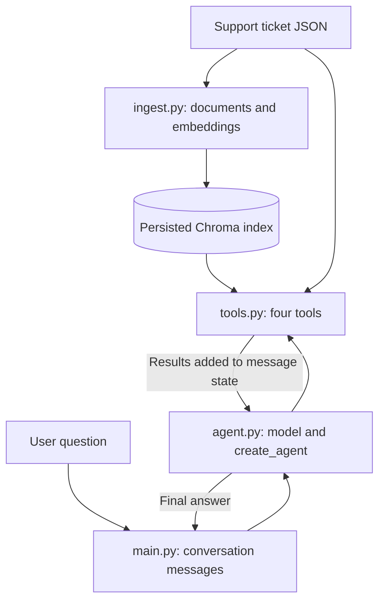

# SupportDesk RAG Agent

A Python command-line assistant that answers questions about historical support tickets using one LangChain agent and four tools. It combines semantic retrieval from a local Chroma database with exact ticket lookup, category filtering, and ticket statistics.

Built as a learning example for retrieval-augmented generation (RAG), tool calling, and conversational message state.

## What it does

- Searches for similar issues and their recorded resolutions.
- Looks up complete ticket details by ID.
- Lists tickets in a category.
- Calculates ticket counts by category and priority.
- Retains conversation history during a session for follow-up questions.
- Instructs the model to cite ticket IDs and acknowledge insufficient evidence.

## Architecture

Ingestion is separate from the agent's runtime. Build the index before starting the assistant; normal startup opens the existing index without re-embedding ticket documents.



The model chooses which tools to request. LangChain executes those tools and returns their results to the model, which can request another tool or produce an answer. The agent does not need to call all four tools for every question.

## Project structure

```text
.
├── agent.py                     # Model, instructions, and agent construction
├── ingest.py                    # Ticket loading, embedding, and Chroma setup
├── main.py                      # Interactive loop and answer extraction
├── tools.py                     # Four tools backed by tickets and Chroma
├── data/
│   └── synthetic_tickets.json   # Sample support tickets
├── requirements.txt
├── .env.example                 # Configuration template without real credentials
├── .gitignore
└── agent_vectorstore/           # Generated locally; excluded from Git
```

## Setup

Use Python 3.12, matching the development environment, and an OpenAI API key with access to the configured models.

Run the following from the project directory.

### 1. Create and activate a virtual environment

macOS / Linux:

```bash
python3.12 -m venv .venv
source .venv/bin/activate
```

Windows PowerShell:

```powershell
py -3.12 -m venv .venv
.venv\Scripts\Activate.ps1
```

### 2. Install dependencies

```bash
python -m pip install --upgrade pip
python -m pip install -r requirements.txt
```

The agent uses LangChain's `create_agent` API, which requires LangChain 1.x or later. The current requirements file includes additional workshop dependencies and allows older LangChain versions; if your environment already has LangChain 0.x, upgrade it:

```bash
python -m pip install --upgrade "langchain>=1.0" langchain-openai langchain-chroma langgraph
```

### 3. Configure your environment

Copy `.env.example` to `.env` in the project directory, then set your own API key:

```dotenv
OPENAI_API_KEY=your-api-key-here
OPENAI_CHAT_MODEL=gpt-4o-mini
OPENAI_EMBEDDING_MODEL=text-embedding-3-small
```

The model names shown above are the application's defaults. Environment variables already set in your shell take precedence over `.env` values.

Keep `.env` local. It is excluded by `.gitignore`.

### 4. Build the Chroma index

```bash
python ingest.py
```

This reads `data/synthetic_tickets.json`, creates one document per ticket, generates OpenAI embeddings, and persists them in `agent_vectorstore/` under the `tickets` collection.

Run ingestion initially and when tickets are added or updated. Repeated ingestion upserts documents using stable ticket IDs. It re-embeds the supplied tickets and does not automatically delete indexed tickets removed from the JSON.

### 5. Start the assistant

```bash
python main.py
```

Type questions at the `You:` prompt. Enter `quit`, `exit`, or `q` to finish. Ctrl+C or end-of-input also exits the loop.

## Four tools

| Tool | Purpose | Example question |
| --- | --- | --- |
| `SearchSimilarTickets` | Retrieve the top three semantically similar tickets from Chroma | How do I fix login failures after a password reset? |
| `GetTicketByID` | Return full details for a specific ticket | Show me ticket TICK-001. |
| `SearchByCategory` | List ticket IDs, titles, and priorities in a category | List tickets in the Database category. |
| `GetTicketStatistics` | Calculate total tickets and category/priority distributions | What are the ticket statistics? |

Category matching is case-insensitive and exact. If a category is unknown, the tool returns available category names. Category listings do not include full resolutions; the agent can use ticket lookup for those details.

The statistics tool currently accepts a string argument that it does not use. The system prompt tells the model to pass an empty string.

## Example conversation

Try these questions in order:

```text
You: How do I fix authentication failures after a password reset?
You: Show me the full details of the ticket you cited.
You: What was the resolution for that ticket?
You: How many tickets are there by priority?
You: quit
```

The actual answers depend on the ticket data and the model's tool choices.

## How conversation history works

`main.py` keeps a list of messages in memory. Each invocation sends the previous messages plus the new user question. The returned state includes user messages, model tool requests, tool responses, and the final assistant answer.

After a successful turn, the application replaces its history with the returned message list. This preserves the context needed to interpret phrases such as “that ticket.”

There is no fixed conversation-turn limit. The configured `recursion_limit=20` bounds internal graph execution steps per invocation, not the number of chat turns. History is not saved across program restarts, and long conversations eventually require trimming or summarization.

## Ticket data

Each ticket must include these fields:

```text
ticket_id, title, description, resolution, category, priority,
created_date, resolved_date
```

Ticket IDs must be unique for ingestion. Both exact lookup and statistics use the JSON data; semantic search uses the persisted index. Re-run ingestion after changing the data so these views remain aligned.

## API usage and limitations

- Ingestion sends ticket document text to OpenAI for embeddings. Semantic searches send query text for embedding; model calls include conversation messages and tool evidence.
- Opening the saved index does not regenerate document embeddings. Model requests and query embeddings still incur API usage.
- Keep the same embedding model when building and querying an index. Changing it requires a compatible, freshly built index; changing only the environment variable does not migrate stored vectors.
- Citation and grounding instructions guide the model but are not a programmatic factual validator. The search tool returns the closest three matches without a relevance threshold, so returned tickets may not answer the question.
- This is a local learning example without persistent chat storage or automatic history summarization.

## Troubleshooting

| Problem | What to check |
| --- | --- |
| Missing `OPENAI_API_KEY` | Add the key to the project `.env` or your shell environment. |
| Chroma index not found | Run `python ingest.py` before `python main.py`. |
| Collection not found | Confirm ingestion and runtime both use the `tickets` collection configured in `ingest.py`. |
| Cannot import `create_agent` | Activate the intended virtual environment and install LangChain 1.x or later. |
| API request failed | Check credentials, model access, quota, and connectivity. |
| Agent reached its execution limit | Rephrase the question more specifically or split it into smaller questions. |
| Missing or outdated semantic results | Re-run ingestion after changing tickets; check embedding-model consistency. |

## GitHub files

Commit source files, `requirements.txt`, the sample ticket JSON, `.env.example`, and this README. The included `.gitignore` excludes `.env`, `.venv/`, Python caches, and `agent_vectorstore/`. Each fresh checkout builds its own Chroma index.
